# Igor's LinkedIn posts not yet made into notes (read 2026-11-28)

Source: linkedin.com/in/vitnyrcoach, "All activity", scrolled to the end.
The profile has **28 posts** (21 Sep to 25 Nov 2026), plus two reposts of
Millie Erd.'s posts, which are left out. Eight posts are already notes and
are not repeated here:

| Post | Note |
|---|---|
| au (18 Nov) | `/notes/au/` |
| CONFLICT (4 Nov) and the stress list (5 Nov) | `/notes/noun-verb-stress/` |
| actual (8 Oct) | `/notes/actual/` |
| serials (23 Nov) | `/notes/serial/` |
| weigh (22 Oct) | `/notes/weigh/` |
| key (30 Oct) and abbreviations (25 Nov) | `/notes/api-key/` |

That leaves the **20 posts below**, newest first within each group. The
text is exactly as posted, typos included ("… more" expanded). Dates come
from the post IDs. Impressions are as LinkedIn showed them on 2026-11-28.

**Images.** Each one is saved next to this file, captured at the size
LinkedIn serves (`dev-deaf.jpg`, `install.jpg` and `redact.jpg` were saved
on the first read). Five images are not Igor's: a press photo, a stock
photo, a film still, a captioned nature picture from elsewhere and a
figure from a paper. Those are
marked **not Igor's** and are gitignored, like `redact.jpg`: kept locally,
never published, because the repo is public. That also means GitHub does
not back them up.

## Index

| # | Date | Post | Kind | Images | Impressions |
|---|---|---|---|---|---|
| 1 | 24 Nov | dev / deaf | Pronunciation | 1 | 3,131 |
| 2 | 29 Oct | install | Pronunciation | 1 | 1,029 |
| 3 | 7 Oct | redact / edit | False friend | 1 (not Igor's) | 1,717 |
| 4 | 5 Oct | café | Pronunciation | 1 | 1,639 |
| 5 | 1 Oct | manage to | Vocabulary | 2 | 1,317 |
| 6 | 23 Oct | Fernweh | Vocabulary (German) | 1 | 868 |
| 7 | 19 Nov | The wood frog (in English) | Other | 1 (not Igor's) | 792 |
| 8 | 29 Oct | When the company course ends | Learning | 1 | 1,727 |
| 9 | 28 Oct | "I thought I'd settle in after three months" | Learning | 1 | 1,083 |
| 10 | 24 Oct | "English isn't for me" | Learning | 1 | 1,317 |
| 11 | 14 Oct | Genes and learning | Learning | 1 (not Igor's) | 1,124 |
| 12 | 13 Oct | "I'm not paid for this": school teachers | Learning | 1 (not Igor's) | 983 |
| 13 | 9 Oct | 900 school hours | Learning | 1 (not Igor's) | 1,275 |
| 14 | 29 Sep | Multitasking | Learning | 1 (photo of Igor) | 1,026 |
| 15 | 25 Sep | Attention residue | Learning | 1 | 1,063 |
| 16 | 24 Sep | Silence or an electric shock | Learning | 1 | 5,902 |
| 17 | 23 Sep | 119 of 467 | Learning | 1 | 4,358 |
| 18 | 22 Sep | Same video, worse memory | Learning | 1 | 714 |
| 19 | 21 Sep | I scroll every day | Learning | 1 | 664 |
| 20 | 28 Sep | Personal brand / the site launch | Other | 2 | 934 |

**Which could be notes.** A note covers one mistake a Russian speaker
really makes. Posts 1-6 fit that. Posts 1-3 were already judged in
`REVIEW.md`: dev/deaf needs Igor's word list, install is thin and fits a
stress note, and redact has no usable picture. Café and manage are new
candidates. Each has Igor's own slides and a clear fix, but is short like
install. Fernweh is a German word, not a mistake. Posts 8-19 are about how
people learn: habits, attention and motivation, citing studies. They don't
fit the note format; they would need a different kind of page (method or
research), which is Igor's call. Posts 7 and 20 are not lessons.

---

# Language posts

## 1. dev / deaf

- Posted: 2026-11-24
- Link: https://www.linkedin.com/feed/update/urn:li:activity:7530918568402513920/
- Images: `dev-deaf.jpg` (two keys, F "deaf" and V "dev")

> Мой клиент девелопер. Когда он говорит I'm dev, слышиться I'm deaf.
> Когда нейтивы улыбаются на встрече это не всегда потому что они очень дружелюбные ребята. Может вы их просто рассмешили. Аккуратнее со звонкими и глухими звуками на конце слов.

## 2. install

- Posted: 2026-10-29
- Link: https://www.linkedin.com/feed/update/urn:li:activity:7521595996909510656/
- Images: `install.jpg` (the right pronunciation)

> Когда устанавливал в детстве игры и не знал английского часто произносился слова по наитию. У некоторых учеников несмотря на уровень до сих пор остались похожие привычки. Последние пару дней это было install. Его коверкают очень по-разному, самые частые случаи это :
> ИНстол ( ударение на первый слог)
> инСТАЛ ( а вместо о)
> ИНстал ( 2 ошибки вместе)
>
> Правильное произношение на слайде.

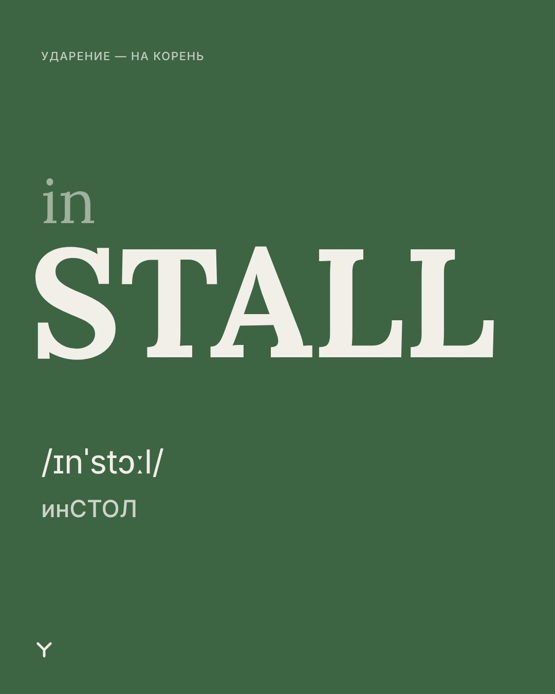

## 3. redact / edit

- Posted: 2026-10-07
- Link: https://www.linkedin.com/feed/update/urn:li:activity:7513553712305319936/
- Images: `redact.jpg`, **not Igor's** (a press photo of a redacted document; gitignored)

> Попросишь коллегу redact твой текст, и получишь документ с черными полосами.
>
> В русском редактировать созвучно с redact. Пару раз слышал от учеников значит пора писать пост. Первый раз увидел это слово когда везде светилась история с файлами Епштейна. Тогда выпустили уйму доков и большая часть из них была замазана. Редактирования не было, скорее цензура.
>
> redact => цензурировать
> edit => редактировать

## 4. café

- Posted: 2026-10-05
- Link: https://www.linkedin.com/feed/update/urn:li:activity:7512837899248381952/
- Images: `cafe.jpg` (cover slide: "PRONUNCIATION · CAFÉ / Что не так с «кафэ» по-английски?")

> Одно из самых mispronounced слов на моих занятиях это café. Мало кто обращает внимание на значок над буквой e. Он указывает на французский origin. Я сам не очень знаю французский, но знаю достаточно чтобы быть аккуратным с произношением. Те с кем я работал поголовно произносят его на русский манер 'кафэ'.
> Что поменять:
> 1. Первый звук. Не русское «а», а /æ/, что-то между «а» и «э». Открываем рот широко.
> 2. Конец. Не «э», а «эй», как в day или okay.
> Итого: [кæфэй].

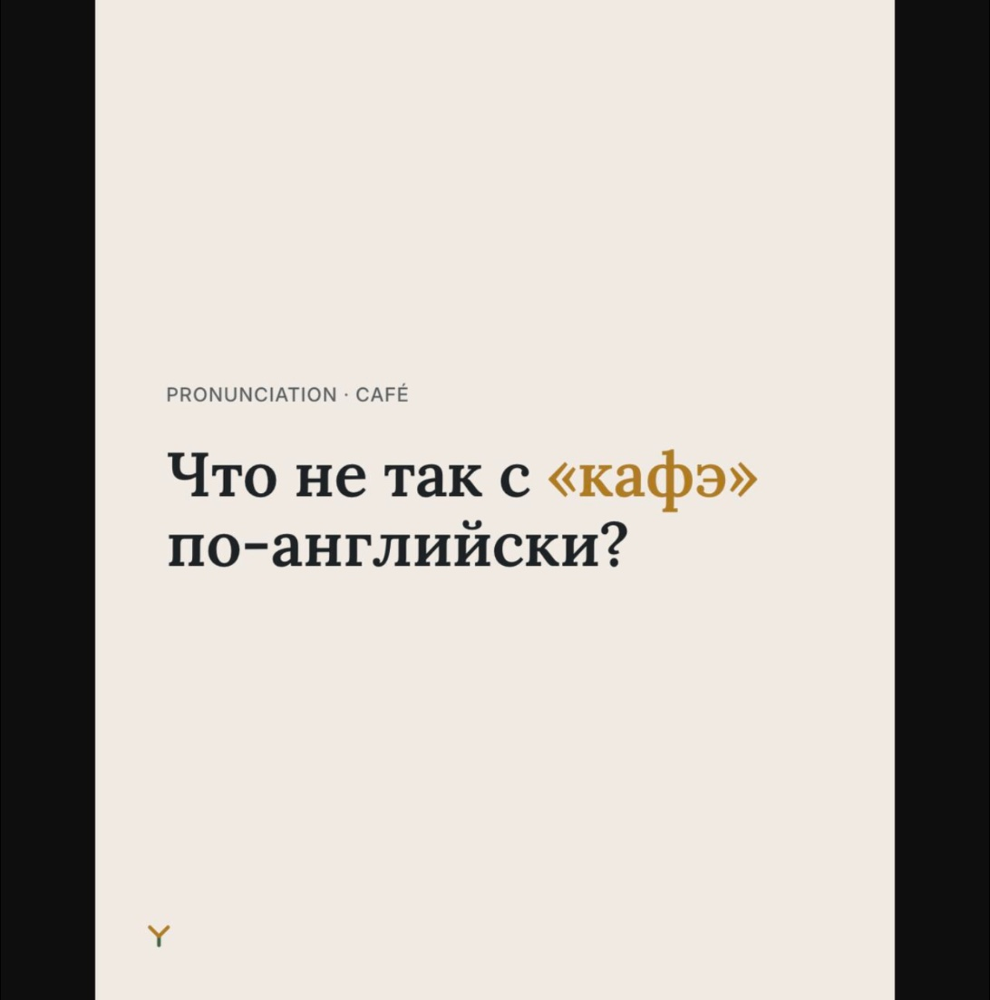

## 5. manage to

- Posted: 2026-10-01
- Link: https://www.linkedin.com/feed/update/urn:li:activity:7511389838995062785/
- Images: `manage-1.jpg` (cover), `manage-2.jpg` (exercise: "Переведи через manage to")
- The exercise slide says "Ответы в первом комментарии", but the post has
  no comment from Igor. Its only comments are from Millie Erd. and Vitalii
  Honcharenko, so the answers were never posted.

> Большинство B1 не знакомы с самым полезным значением слова "manage"
> Когда спрашиваю у клиентов обычная ассоциация со словом "управлять". У него есть еще одно, более универсальное и полезное.
> manage to => справиться , получиться => Когда чтото было непросто но ты смог.
> I'll manage => Я справлюсь.
> I managed to fix the bug => У меня получилось пофиксить баг.

Slide 2, as written: "Переведи через manage to / 1. Мне удалось задеплоить
до пятницы. / 2. Не переживай, я справлюсь. / 3. У нас не получилось
договориться с клиентом. / Ответы в первом комментарии."

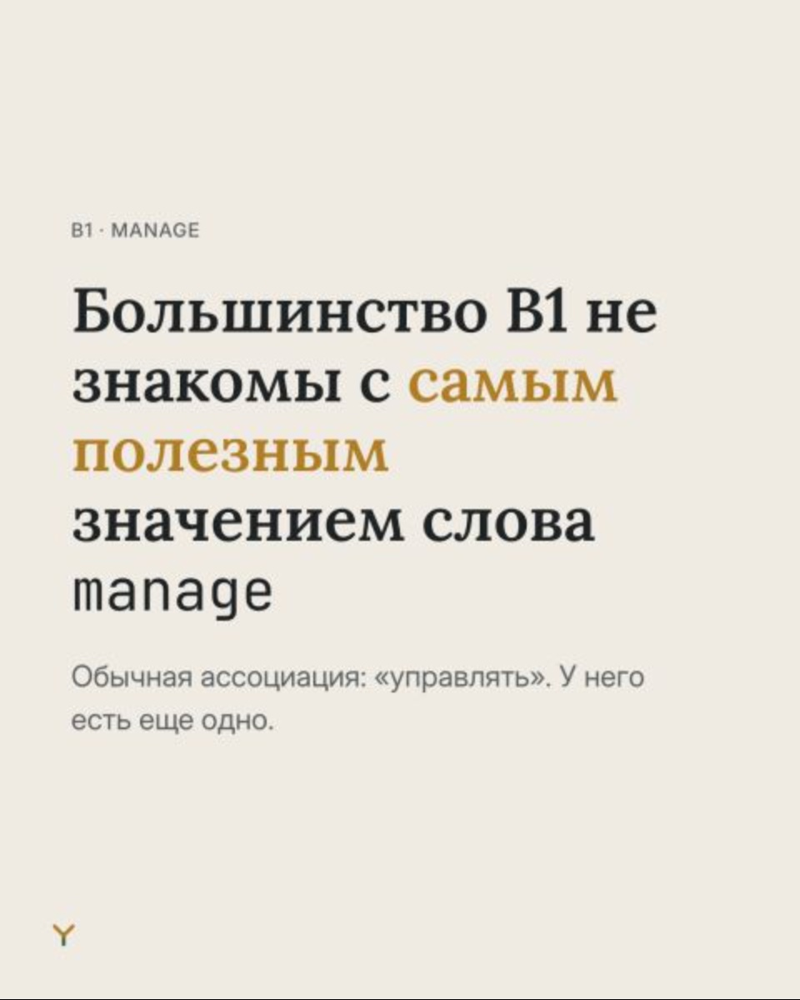
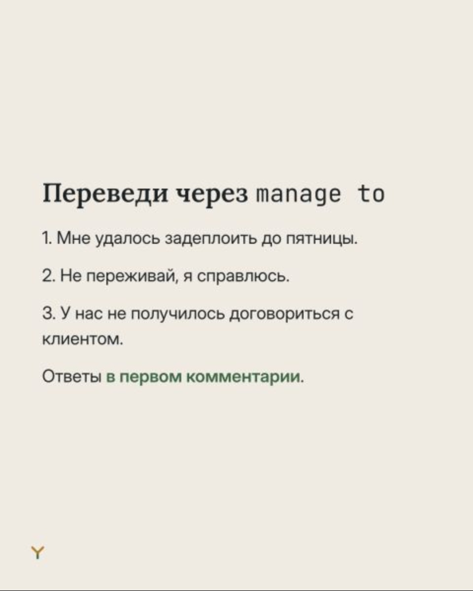

## 6. Fernweh

- Posted: 2026-10-23
- Link: https://www.linkedin.com/feed/update/urn:li:activity:7519352146698448896/
- Images: `fernweh.jpg` (a dictionary page: Fern·weh, ['fɛʁnˌveː], "тоска по далёким местам, где ты ещё не был"; ср. Heimweh, англ. homesick)

> Мне нравится идея хватать слова из других языков если нету хорошего эквивалента.
> В английском есть целый словарь из слов позаимствованных напрямую из франзуского, латинского, немецкого. Если нужно вспомнить я их вспомню но применить в реальном разговоре не так просто).
>
> Недавно смотрел видео про агрессивность немецкого языка. Там дали пару примером особенных слов которые можно перенести на свой язык. Одним из таких слов был Fernweh. Если ты знаком со словом homesick (скучать по дому) то вывернув это слово наизнанку получится fernweh ( скучать по отдаленным неизведанным местам).
> Я очень редко скучаю по дому. Наверное я не homesick type of person, but a fernweh person. Are you?

## 7. The wood frog (written in English)

- Posted: 2026-11-19
- Link: https://www.linkedin.com/feed/update/urn:li:activity:7529125131198296066/
- Images: `frog.jpg`, **not Igor's** (a captioned picture from elsewhere, "THE ALASKAN WOOD FROG FREEZES SOLID IN WINTER"; gitignored)

> I rarely post about nature or in English but it's good practice for anyone who reads my posts.
> I've been reading up on cryogenics and thinking about potential human revival. A lot of advances in science have been inspired by nature. Recently stumbled on this fascinating frog. It can freeze itself in winter and come back to life. Maybe if we study them closely we could figure out how to freeze a person for 50 years and give them a new life in the world of the future.

---

# Learning posts

## 8. When the company course ends

- Posted: 2026-10-29
- Link: https://www.linkedin.com/feed/update/urn:li:activity:7521484842685997056/
- Images: `group-course.jpg` (a stool: "Интерес стоит на нескольких ножках": компания, преподаватель, соревнование, темы; "Три ушли вместе с курсом. Новую ставят сразу.")

> Компания год оплачивала тебе английский. Группа, преподаватель, вторник и четверг в 19:00. Ты ходишь, все в кайф, есть прогресс.
>
> Бюджет урезают и курс заканчивается. Ты по инерции скачиваешь приложение, открываешь три раза и до свидания.
>
> Не у каждого есть способность заниматься самостоятельно. Если дисциплина и интерес умирают от потери групповой поддержки и есть задача выучить язык лучше быстро создать себе второй комитмент.
>
> Интерес это многофакторный атрибут, он может держаться на преподавателе, темах, компании с которой ходишь, соревновательном духе. У него будут ups and downs, если не подложить соломку легко оказаться в ситуации где 2-недельный перерыв превращается в год. И то интервью в faang все также далеко.

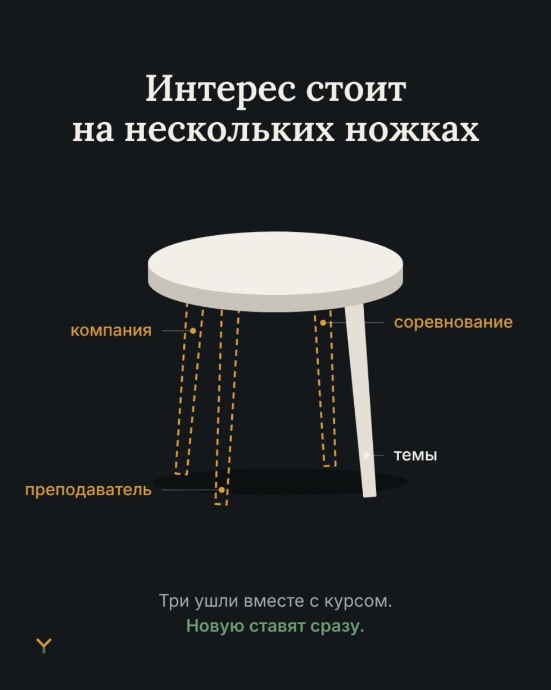

## 9. "I thought I'd settle in after three months"

- Posted: 2026-10-28
- Link: https://www.linkedin.com/feed/update/urn:li:activity:7521104806770565120/
- Images: `interest-grown.jpg` ("Интерес ~~находят~~ выращивают." O'Keefe, Dweck, Walton, 2018)

> «Я думал месяца через три втянусь и станет легко. Как с новым фреймворком»
>
> Так мне сказал бэкенд-разработчик на 8-м месяце английского c A2.
> Пару недель назад у него был первый созвон с командой из Дании. Три раза «sorry, can you repeat», потом выключил камеру. И на стрессе пропустил два урока подряд.
>
> В 2018-м психологи из Стэнфорда проверили что делает с людьми совет «найди свою дело/интерес». Те кто верил что интерес находят, ждали от него бесконечной мотивации. Когда задача усложнялась и интерес падал заметно сильнее.
> Если веришь что страсть к делу находят, каждая ошибка и разочарование выглядит как доказательство что нашел не то. Отсюда «не моё».
>
> Мы поработали над этим. Амбиции ослабли, мотивация вернулась.

## 10. "English isn't for me"

- Posted: 2026-10-24
- Link: https://www.linkedin.com/feed/update/urn:li:activity:7519691733958434817/
- Images: `not-mine.jpg` (a loop: «Это не моё» → Занимаюсь меньше → Результат хуже → «Ну точно не моё»; "Рвать её нужно в первой точке. Не «не моё», а «пока не умею».")

> Почему "английский - это не моё" самый деструктивный приговор ты можешь себе вынести.
>
> Есть такое понятие как self-fulfilling prophecy. Когда твои мысли сбываются. Механизм очень простой. Ты во что-то веришь это отражается на твоих действиях, твои действия дают результат ты начинаешь верить во чтото еще сильнее. Поверив что "это не моё" ты уже предопределил паттерн своих будущих стараний, работы над собой, количество практики и многое другое.
>
> Часто работая с людьми я в первую очередь прощупываю их веру в свои способности и навыки. Они всегда сильно коррелируют с тем сколько усилий вкладывается, как человек справляется с трудностями, испытывает ли интерес. Часть моей работы это показать человеку что он "могёт". И что самый большой камень на его пути это не present perfect а его впечатление о самом себе.

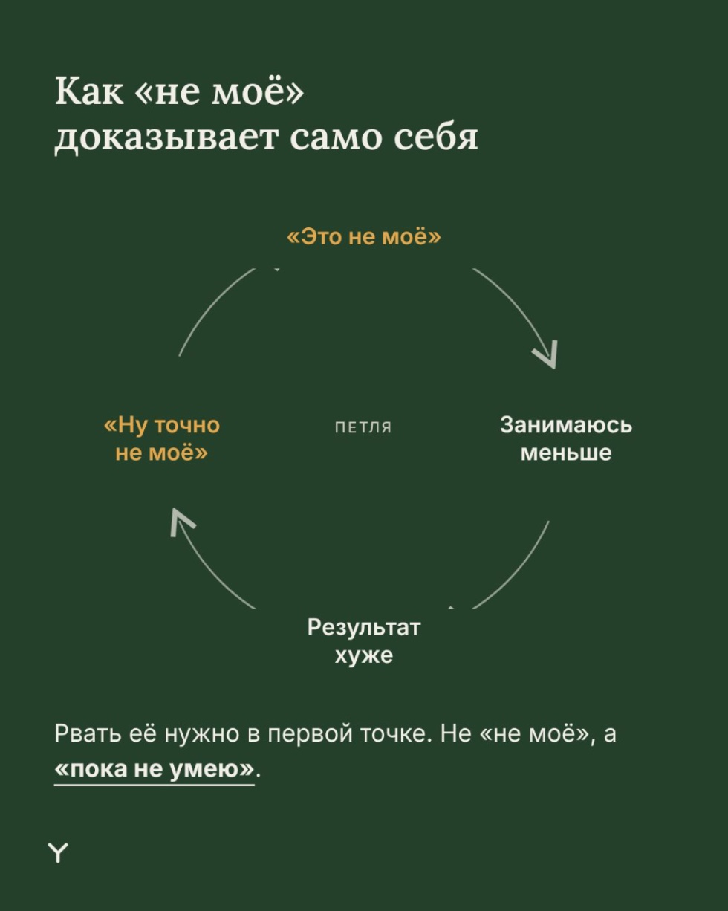

## 11. Genes and learning

- Posted: 2026-10-14 (edited)
- Link: https://www.linkedin.com/feed/update/urn:li:activity:7516090819481661440/
- Images: `genes.jpg`, **not Igor's** (a figure from a paper: IQ scores, cortex thickness, dendrites; gitignored)

> Есть тема о которой люди предпочитают молчать. "Как гены влияют на способность учиться?".
>
> Скорость и успех в оценках в школе между людьми 60% зависит от генов. Остальные 40% это окружение. И на эти 60% ты не можешь особо повлиять. Если оставить оценки за кадром и обратить внимание на то как осваиваются навыки то упорную работу оценили в 20-30%, в то время как гены + возраста когда ты начал в остальные 70-80%. Это неудобный факт, которые расстраивает большое количество людей.
>
> Но есть и положительные стороны. В исследованиях люди которые осваивали язык в 1.5-2 раза медленее все равно иногда приходили к одному и тому же уровню что и более способные ученики. Скорость будет разной для всех. Нам лишь приходиться разыгрывать карты которые нам дали при рождении.

## 12. "I'm not paid for this": school teachers

- Posted: 2026-10-13
- Link: https://www.linkedin.com/feed/update/urn:li:activity:7515761150731677696/
- Images: `school-unpaid.jpg`, **not Igor's** (a stock photo, a teddy bear slumped on a sofa; gitignored)

> "Мне за это не платят" или Почему ты не смог выучить английский в школе?
>
> TALIS посчитали - препод в школе работает 43 часа в неделю. 24 из них это уроки, остальные 19 это бумажки за которые не платят. Если почти половина твоей рабочей недели это неоплачиваемый труд сложно удивляться тому что учителя приходят открывают книгу и идут по страничкам. Burnout, отсутствие мотивации и нулевые incentives чтото делать это стандарт жизни учителя. Если у человека нету ресурса и желания учить, то эти 900 часов потраченных на иностранные языки в школе настолько же полезные как и чтение скрижалей на мертвом языке.

## 13. 900 school hours

- Posted: 2026-10-09
- Link: https://www.linkedin.com/feed/update/urn:li:activity:7514263593337511936/
- Images: `school-900-hours.jpg`, **not Igor's** (a film still of a celebrity; gitignored)

> Почему большинство людей выходят со школы не зная языка.
> Недостаток времени на занятии не может быть виновником => в Кэмбридже оценивают время до б2 в районе 600 часов. В среднем в России/Беларуси на иняз дают 900 часов за 11 классов. Может быть причина в том куда эти 900 часов уходят. 1 занятие идет 45 минут из них половину говорит учитель, вторую половину группа из 10 человек. На одного человечка выйдет по 2+ минуты использования языка.
>
> ps all numbers are approximate 😉

## 14. Multitasking

- Posted: 2026-09-29
- Link: https://www.linkedin.com/feed/update/urn:li:activity:7510684523060428802/
- Images: `multitasking.jpg` (a photo of Igor writing in a notebook at a laptop, outdoors; a real photo of him, so usable on the site)

> Мультизадачность мешает обучению. Даже если на уроке у тебя все отлично получается.
>
> В 2006 году Фёрде, Ноултон и Полдрак провели эксперимент. Люди учились угадывать погоду по специальным карточкам, причем один набор карточек они учили спокойно, а другой параллельно считая звуковые сигналы в наушниках.
>
> На тесте разницы не было. Но когда вопрос перевернули и спросили какие карточки значат дождь, с набором который учили с мультитаском люди начали проседать.
>
> Засканив мозг они увидели вот что. При спокойной учебе работала память на факты. При мультитаске ее место заняла система привычек, та же что везет тебя домой на автопилоте. Привычка работает пока все как на тренировке. Шаг в сторону и она теряется.
>
> Что это значит для моих учеников. Если ты учишь английский под музыку, сериал или болтая с другом, в моменте ты можешь все отлично понимать. Проблема наступит когда переменные немного поменяются и информацию нужно использовать в новом контексте.
>
> Выучил слово в одном значении, а в тексте оно в другом, и ты его не узнаешь. Разобрал Present Perfect на примерах из учебника, а в разговоре ситуация чуть другая, и ты не можешь выбрать время.
> Понимать не равно уметь.
>
> Задумайся что у тебя сейчас играет на фоне, пока ты учишь.

## 15. Attention residue

- Posted: 2026-09-25
- Link: https://www.linkedin.com/feed/update/urn:li:activity:7509248155364864002/
- Images: `attention-residue.jpg` ("ATTENTION RESIDUE / Пальцы закрыли рабочий чат. Голова — нет." A process table: english_lesson открыт, work_chat закрыт, работает в фоне. Leroy, 2009)

> Представим: ты закрыл рабочий чат и сел изучать что нибудь. Голова все еще в чате?
>
> Это не лень. И не "плохая концентрация". У этого есть название: attention residue или остаток внимания.
>
> Софи Лерой в 2009 году проверила это в экспериментах: людей переключали с одной задачи на другую, и часть внимания так и оставалась на первой, поэтому вторую они делали хуже, особенно если первая осталась незаконченной.
>
> Как в компьютере. Окно закрыл, а процесс висит в фоне и ест оперативку.
>
> Моим ученикам которые занимаются во время рабочего дня часто приходиться отвечать на сообщения по работе.
> Но "быстренько ответить на пару сообщений" стоит дороже чем кажется.
> Это вкладка забирает ресурс. Мозг не умеет закрывать вкладки сам.
>
> Что помогает:
> 1. Добить. Если задачу можно закончить за 5 минут, закончи и только потом садись за английский.
>
> 2. Не можешь добить? Запиши одну строчку: где остановился и что делать дальше. В исследовании Лерой 2018 года такой план на возвращение уменьшал этот остаток.
>
> 3. Не открывать чат "на минутку" перед уроком. Минутка никогда не бывает минуткой))

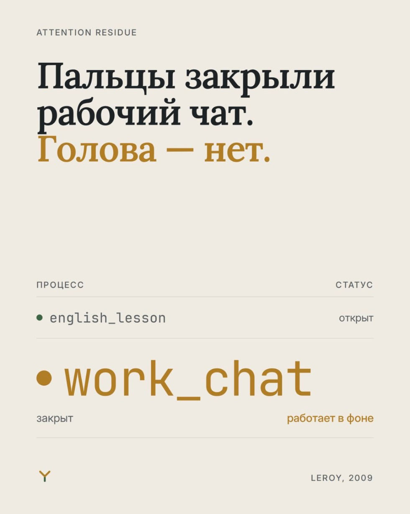

## 16. Silence or an electric shock

- Posted: 2026-09-24
- Link: https://www.linkedin.com/feed/update/urn:li:activity:7508848410226216960/
- Images: `electric-shock.jpg` ("SCIENCE, 2014 · 15 МИНУТ В ПУСТОЙ КОМНАТЕ / Тишина или удар током?" Мужчины 12 из 18 нажали, женщины 6 из 24. "Лишь бы не оставаться наедине со своими мыслями.")

> Две трети мужчин и четверть женщин в эксперименте выбрали удар током, лишь бы не сидеть 15 минут наедине со своими мыслями. И как это связано с изучением английского.
>
> Это Science, 2014. Людей оставляли одних в пустой комнате. Ни телефона, ни книги. Только кнопка, которая бьет током. Причем все они до этого честно сказали, что заплатили бы, лишь бы этот удар не получать.
> Большинство нажало раз-два)) 15 минут тишины оказались для многих хуже боли.
>
> В прошлом посте было про 467 человек, из которых отключить мобильный интернет хотя бы на 10 дней смогли только 119. Вот одна из причин почему.
>
> Думаю дело не в силе воли. Когда ты что-то убираешь, остается пустота. В пустоте жить тяжело. Мы сразу тянемся к тому что отлично ее заполняло.
> Поэтому обычное удаление приводит к тяжелым паре-тройке дней и возвращению к той же привычке.
>
> Я убираю все, кроме одной вещи. Когда сажусь работать, на экране остается одна задача: мозгу есть за что держаться. Нужно всегда найти достойную замену.
>
> Касательно английского(и любого другого навыка): выключить телефон в метро мало. Надо заранее решить, что будет вместо: подкаст, книга или просто прогнать в голове вчерашние слова.
>
> Задумайся как часто ты заполняешь пустоту мусором?

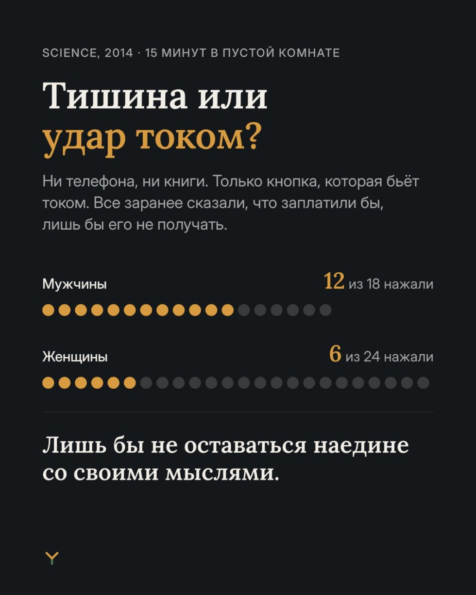

## 17. 119 of 467

- Posted: 2026-09-23
- Link: https://www.linkedin.com/feed/update/urn:li:activity:7508523684584849408/
- Images: `removal.jpg` ("ПРИМЕРНО КАЖДЫЙ ЧЕТВЁРТЫЙ / 119 из 467 продержались 10 дней без мобильного интернета", a dot grid, "Learning is often removal.")

> 467 человек согласились на две недели отключить мобильный интернет на телефоне. 10 дней продержались только 119.
> Остальные либо сдались по дороге, либо вообще не включили блок. Таких, кстати, было почти половина.
>
> А у тех, кто выдержал, экранное время упало с 314 до 161 минуты в день. Well-being и ментальное здоровье пошло вверх. А способность держать фокус улучшилась так, будто откатили 10 лет.
>
> Но главная цифра для меня тут 119 из 467. Примерно каждый четвертый.
> Убрать на пару дней может каждый. А вот убрать и не притащить обратно, когда рука сама тянется к телефону, это уже другое. Это и есть challenge.
>
> Когда мне надо реально сфокусироваться, я удаляю все лишние приложения, закрываю все вкладки и программы. На экране одна вещь. Остальное просто перестает существовать. Это радикально, но это работает.
>
> С учебой то же самое. Мы все время добавляем: еще приложение, еще курс, еще канал с "полезным английским". А прогресс часто начинается, когда что-то убираешь.
>
> Learning is often removal.
>
> Подумайте что вам стоит убрать чтобы сделать шаг вперед.

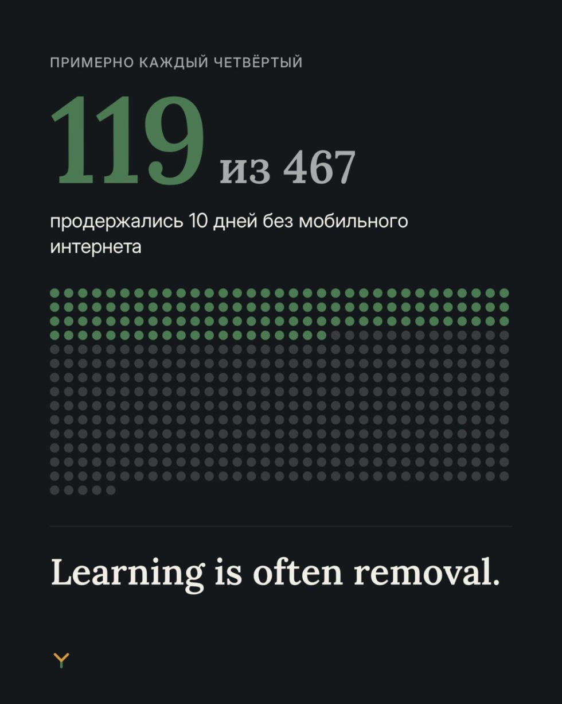

## 18. Same video, worse memory

- Posted: 2026-09-22
- Link: https://www.linkedin.com/feed/update/urn:li:activity:7508084195173445632/
- Images: `short-video.jpg` ("Same video. Worse memory." npj Science of Learning, Jan 2026 · n = 57)

> Исследователи нарезали видос на кусочки. Одной группе показали целый, второй нарезанный. Кто запомнил хуже?
>
> В npj science of learning январь 2026 вышла статья. Ученые решили сравнить длинный и короткий формат видео для обучение. Тот же контент. Мрт показало меньшую активность мозга в зонах отвественных за интеграцию информации для короткой формы. Нарезка мешает собрать информацию в кучу. Если пытаешься учиться через короткую видосики, ты уже плывешь против течения.

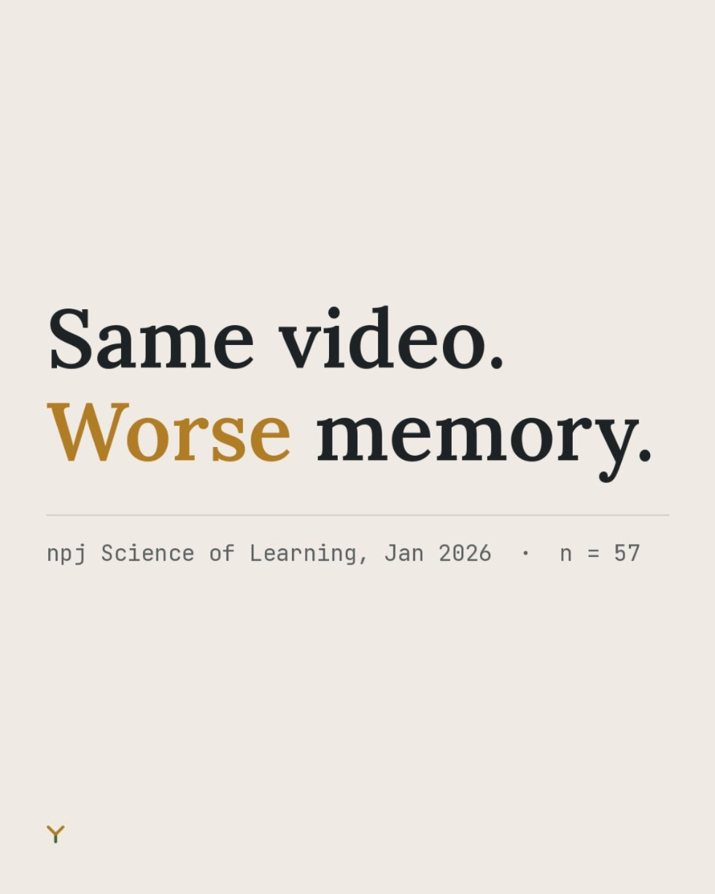

## 19. I scroll every day

- Posted: 2026-09-21 (the first post on the profile)
- Link: https://www.linkedin.com/feed/update/urn:li:activity:7507706557992988673/
- Images: `scroll.jpg` ("I scroll every day." 2.5 h/day = 30+ days a year)

> Обучение это не только про добавление, часто это про уменьшение шума от вещей которые мешают учиться. Я в основном смотрю полнометражки на ютубе и обычно перед сном. В любое время дня меня не интересует ни фид в инсте ни в линке (б-же упаси). У многих с кем я общаюсь такая проблема существует. 5 минутный скролл превращается в 50 минутный. Иногда 50 минутный превращается в 5 часовой. Т.к. многие часто жалуются на то что у них нету времени изучать новые скиллы, но при этом есть время на 3часа инсты в день, я разберу в следующих постах, как перестать хотеть листать. Как это влияет на твой мозг. Чем заняться вместо этого.
>
> Для старта серии немного цифр.
> Взрослый ч. в среднем по миру 2.5 часа в день на соц сети.
> 2.5 часа в день это 30+ суток в год. Sad but true

---

# Other

## 20. Personal brand / the site launch

- Posted: 2026-09-28
- Link: https://www.linkedin.com/feed/update/urn:li:activity:7510325229114658817/
- Images: `personal-brand-1.jpg` (the "Your move." lockup: English, "Your turn to speak."; Chess, "1… The board is waiting."; Climbing, "The next grade."), `personal-brand-2.jpg` (a usage screenshot: 120 sessions, 68,923 messages, 30.8M tokens, 24 active days)

> Месяц назад я решил склепать 'personal brand'. Без какой то высшей цели. Мини эксперимент чтобы понять что получиться. Я сделал имя, лого, описал свою историю. Начал пилить вебсайт. 0 опыта в вайбкодинге. Было очень весело и утомительно. Я кайфанул и зае№?"!. 3 недели спустя it's live. vitnyrcoach.com. всем кто посмотрим и даст фидбек буду очень благодарен

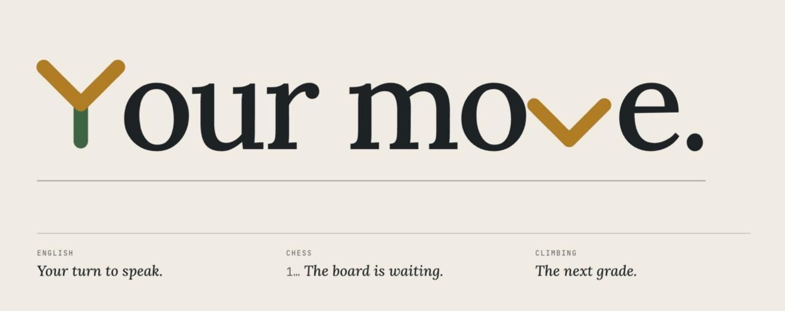
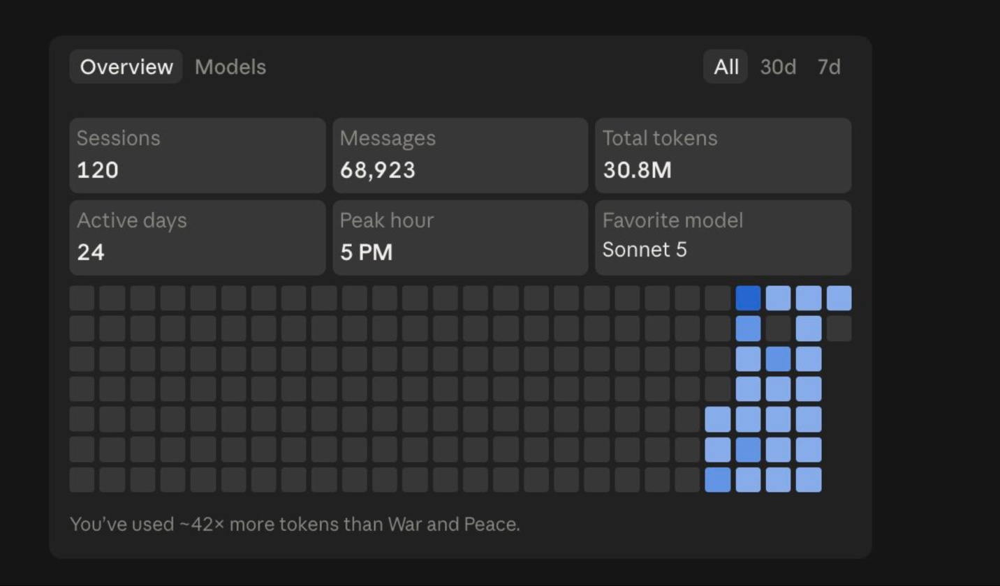

---

## Igor's own slide files

`~/Downloads` holds what look like the source files for several slides,
at full size: `cafe-slide.png`, `manage-slide-1.png` and
`manage-slide-2.png`, `fernweh-images/`, `ostatok-slide.png` (attention
residue), `udar-tokom-slide.png` (electric shock),
`vitnyr-slide-removal.png`, `vitnyr-same-video-worse-memory-cream-1080x1350.png`
and `vitnyr-i-scroll-every-day-dark-1080x1350.png`. They have not been
checked against what was posted. Use them when building a note from one of
these posts.
