# Igor's LinkedIn posts (8, collected 2026-11-28)

Source: linkedin.com/in/vitnyrcoach, recent activity. Text as posted, "… more" expanded.

## abbreviations

- Posted: 2d before 2026-11-28
- Link: https://www.linkedin.com/feed/update/urn:li:activity:7531299698327023617/
- Images: abbreviations.jpg (1080×1350)

> Поговорим немного про аббревиатуры. CEO, API, MR, PR 
>
> Часто клиенты бутчерят их в мясо. Мой апи не работает. Мой сео сказал бла-бла. Это классно и понятно на русском. Усложняет понимание на английском. У аббревиатур есть простое правило. Если 2-3 буквы в слове значит читаем по буквам.
> CEO = си и оу
> API = эй пи ай 
> MR = эм ар 
> итд.

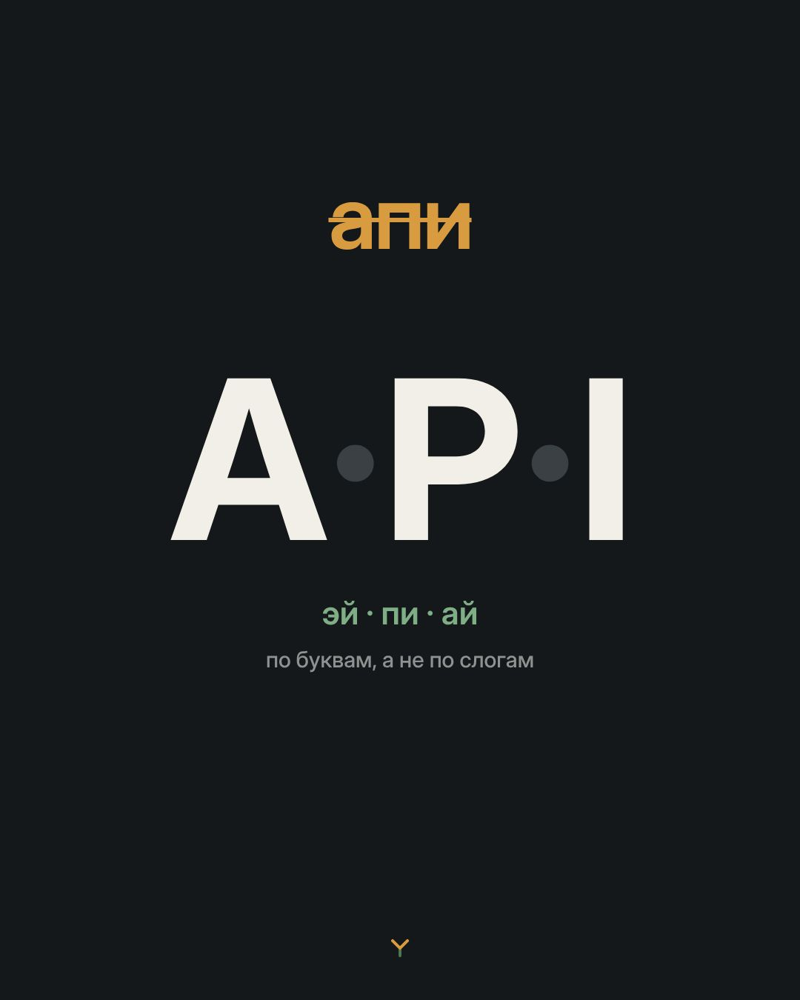

## dev-deaf

- Posted: 3d before 2026-11-28
- Link: https://www.linkedin.com/feed/update/urn:li:activity:7530918568402513920/
- Images: dev-deaf.jpg (1080×1350)

> Мой клиент девелопер. Когда он говорит I'm dev, слышиться I'm deaf. 
> Когда нейтивы улыбаются на встрече это не всегда потому что они очень дружелюбные ребята. Может вы их просто рассмешили. Аккуратнее со звонкими и глухими звуками на конце слов.

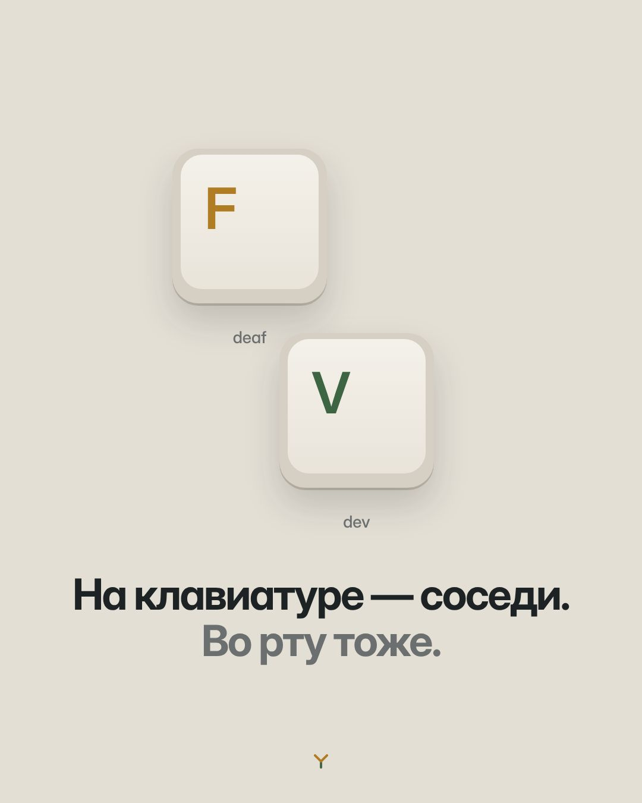

## serials

- Posted: 4d before 2026-11-28
- Link: https://www.linkedin.com/feed/update/urn:li:activity:7530525758075658240/
- Images: serials.jpg (1080×1350)

> "Я люблю наблюдать за хлопьями" Когда на уроке речь заходит о сериалах часто слышу эту ошибку. 
> I love watching serials. Нейтив спикеру это слышиться как " I love watching cereals" 
> Сериал не "Serial" . "Serial" обычно означает серийный ( serial killer, serial number and so on) 
> Для сериалов мы используем слова Tv series или  tv show. 
>
> Слово "Series" часто путают со словом "Серия" в английском это будет слово 'Episode' 
>
> Еще необычный нюанс со словом 'Series'. Оно одновременно и в ед. числе и в мн. числе. 1 series, 2 series, 3 series.

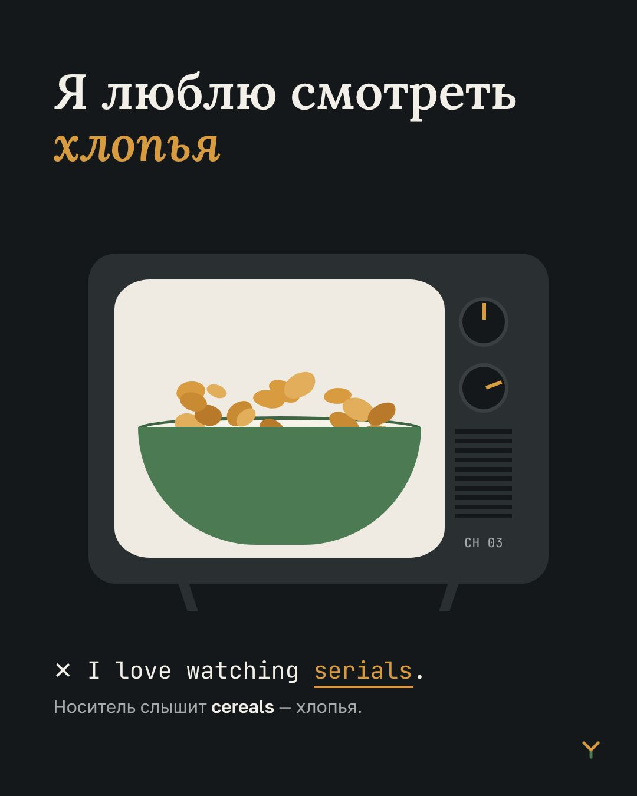

## weigh

- Posted: 1mo before 2026-11-28
- Link: https://www.linkedin.com/feed/update/urn:li:activity:7518999079339737088/
- Images: weigh.jpg (1080×1350)

> I've seen this mistake a thousand times. And it's understandable. These things are easy to confuse. I'm talking about 'weight' and 'weigh.
>
> Most people have a hard time telling them apart. Weight is a relatively simple word that many people know. Nouns in English often work overtime as verbs. So what tends to happen is that people start using 'weight' as a verb. Sentences like:
> I weighted 80 kg. It weights 2 pounds. They are very common in russian speaking community. 
> The right way is to drop 't' and say 'weigh' /weı/ which is the same pronunciation as the word 'way'

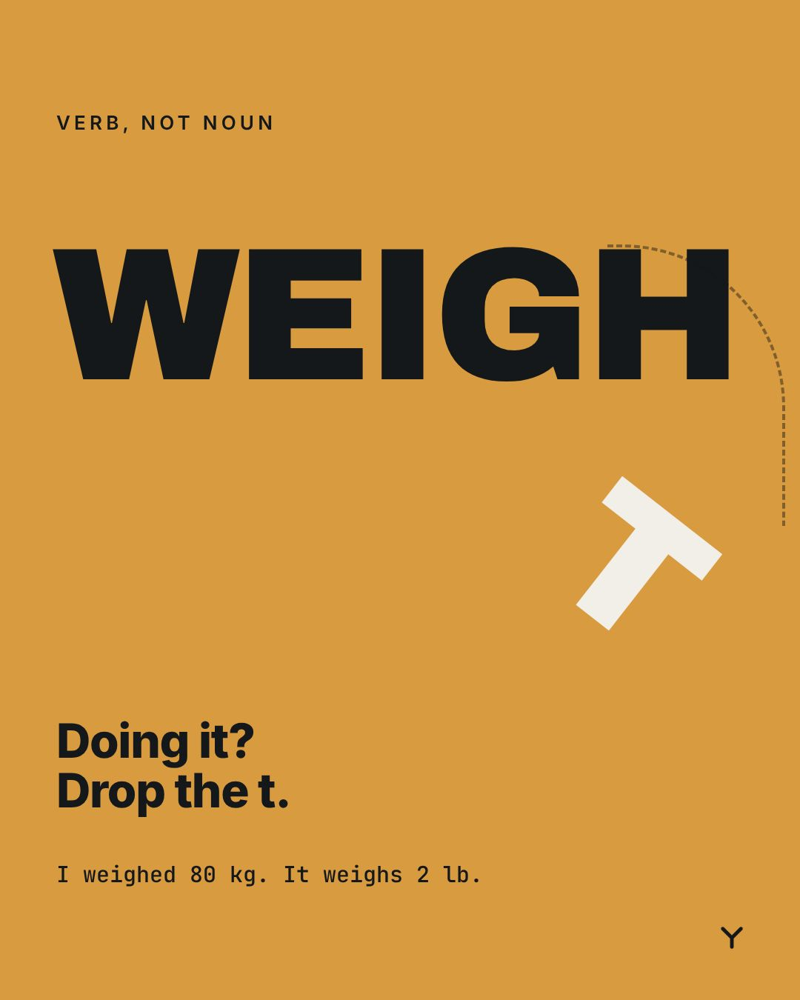

## key

- Posted: 4w before 2026-11-28
- Link: https://www.linkedin.com/feed/update/urn:li:activity:7521873815056969728/
- Images: key.jpg (1080×1350)

> Заметил, что многие программисты по привычке произносят слово key как [кей]. Слово часто всплывает еще и в hotkey, keyboard, keynote. Та же ошибка во всех словах. Когда произносишь [кей], нейтив и человек, который хорошо знает алфавит, слышат букву «K».
> Без очевидного контекста ты скорее всего запутаешь собеседника. don't do that)

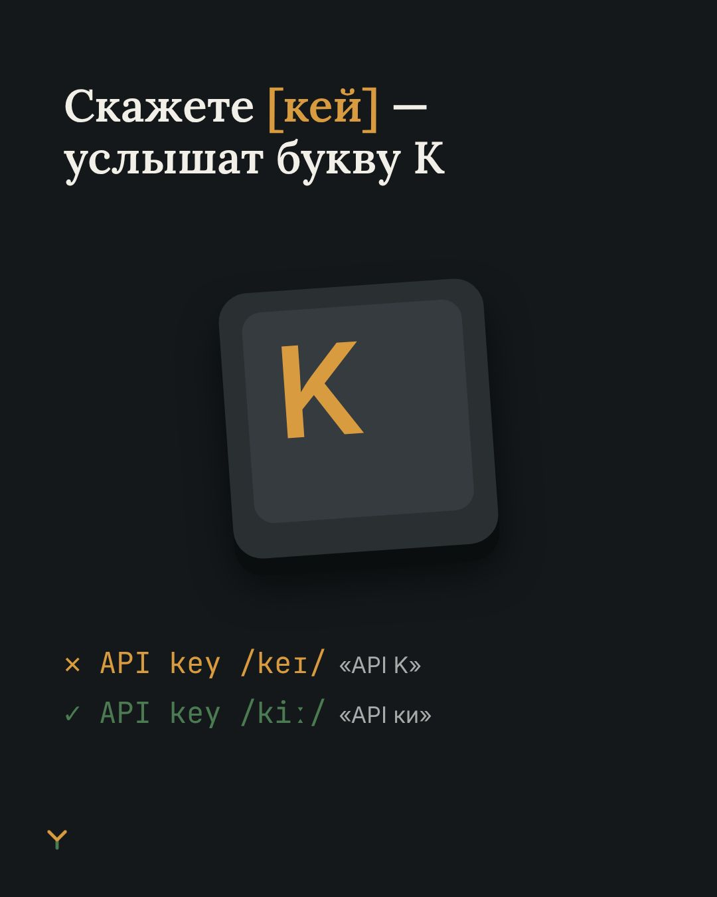

## install

- Posted: 4w before 2026-11-28
- Link: https://www.linkedin.com/feed/update/urn:li:activity:7521595996909510656/
- Images: install.jpg (1080×1350)

> Когда устанавливал в детстве игры и не знал английского часто произносился слова по наитию. У некоторых учеников несмотря на уровень до сих пор остались похожие привычки. Последние пару дней это было install. Его коверкают очень по-разному, самые частые случаи это :
> ИНстол ( ударение на первый слог)
> инСТАЛ ( а вместо о) 
> ИНстал ( 2 ошибки вместе) 
>
> Правильное произношение на слайде.

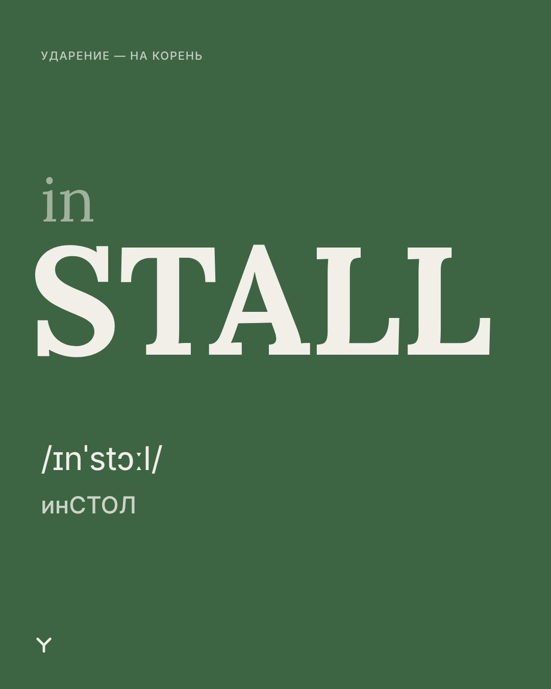

## actual

- Posted: 1mo before 2026-11-28
- Link: https://www.linkedin.com/feed/update/urn:li:activity:7513908883929825280/
- Images: actual-1.png (641×801), actual-2.png (641×801), actual-3.png (641×801), actual-4.png (641×801), actual-5.png (641×801)

> Если ты пишешь в рабочий чат «Is this task still actual?», у меня для тебя плохие новости.
>
> Actual звучит как "актуальный", по значению ближе к "настоящий, действительный, реальный".  
> Рабочие варианты использования: 
> The actual deadline is Friday. 
> We had estimated about 300 visitors, but the actual number was much higher.
>  Альтернативы слову "актуальный" в слайдах.

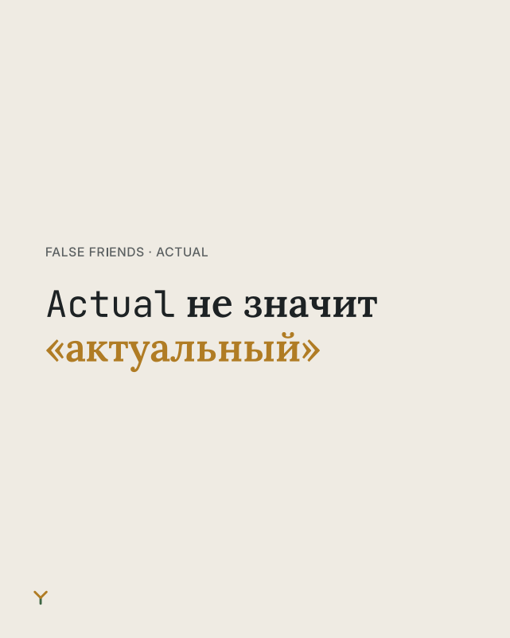
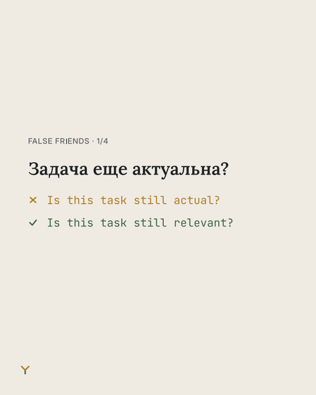
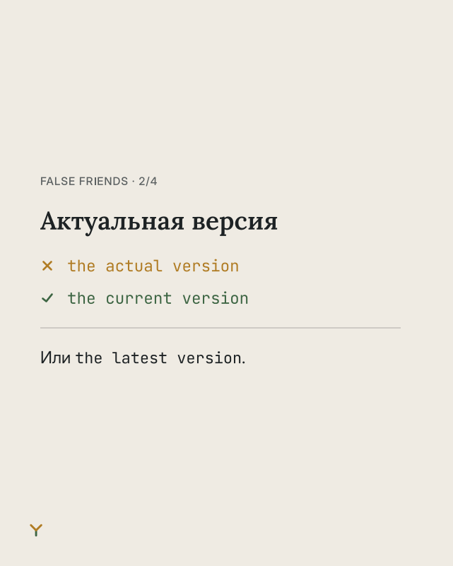
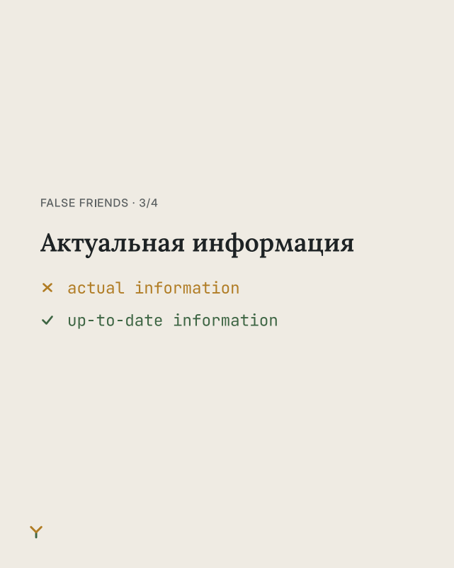
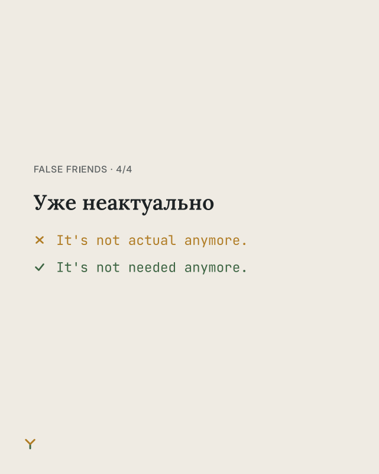

## redact

- Posted: 1mo before 2026-11-28
- Link: https://www.linkedin.com/feed/update/urn:li:activity:7513553712305319936/
- Images: redact.jpg (2048×1365)

> Попросишь коллегу redact твой текст, и получишь документ с черными полосами.  
>
> В русском редактировать созвучно с redact. Пару раз слышал от учеников значит пора писать пост. Первый раз увидел это слово когда везде светилась история с файлами Епштейна. Тогда выпустили уйму доков и большая часть из них была замазана. Редактирования не было, скорее цензура. 
>
> redact => цензурировать 
> edit => редактировать

